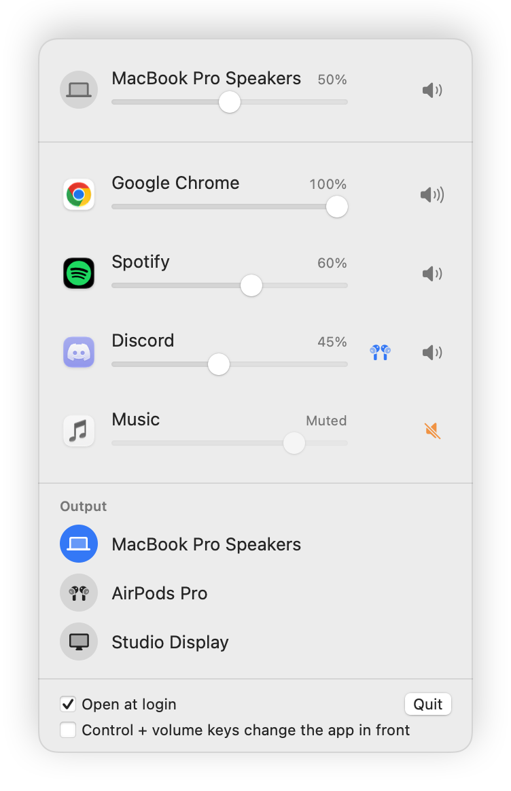

# Volume Mixer


A free menu bar app that gives every Mac app its own volume slider and mute button, like the volume mixer on
Windows. Nothing to install besides the app: no audio driver, no kernel extension. It uses the Core Audio
process taps that macOS 14.4 and later provide.

- A slider and a mute button for each app that plays sound, and the output device's own volume on top
- Pick the output device from the same panel
- Browsers and Electron apps play sound from helper processes; those fold into their app (Chrome, Safari, Discord)
- Volumes are remembered per app
- Apps at 100% are never touched. Only apps you turn down or mute go through the mixer
- Universal app for Apple silicon and Intel Macs

<picture>
  <source media="(prefers-color-scheme: dark)" srcset="docs/screenshot-dark.png">
  
</picture>

## Install

1. Download `VolumeMixer-<version>.zip` from [Releases](../../releases), unzip it and move **VolumeMixer** to
   Applications.
2. Open it. macOS says it cannot check the app for malware, because Volume Mixer is not signed with a paid Apple
   Developer ID. Click **Done**, then open **System Settings → Privacy & Security**, scroll down and click
   **Open Anyway** next to Volume Mixer.
   If you prefer the terminal: `xattr -dr com.apple.quarantine /Applications/VolumeMixer.app`
3. Click the sliders icon in the menu bar. The first time you turn an app down, macOS asks to let Volume Mixer
   record system audio. Click **Allow**: that is how an app's sound reaches the mixer. Nothing is recorded or
   saved, and the app makes no network connections.

If you clicked Don't Allow, turn Volume Mixer on under **System Settings → Privacy & Security → Screen & System
Audio Recording → System Audio Recording Only** and press **Try Again** in the panel. Until then every app plays
at full volume.

## Build from source

Needs macOS 14.4 or later and Swift 5.9 or later. The Command Line Tools are enough (`xcode-select --install`).

```sh
scripts/build.sh            # builds build/VolumeMixer.app for this Mac
scripts/build.sh run        # builds and launches it
scripts/build.sh install    # copies it to /Applications and launches it
scripts/format.sh           # formats the code with swift-format
scripts/check.sh            # formatting, build without warnings, core checks, bundle checks
scripts/release.sh          # universal app zipped for a release
```

The code follows the formatting of Apple's SwiftNIO (`.swift-format`): `scripts/format.sh` applies it and
`scripts/check.sh` fails on anything it would change.

## How it works

For each app below 100% the mixer creates a muted process tap, which takes the app's audio before it reaches the
speakers, and a private aggregate device that holds the tap and the real output device. The aggregate device's
IO callback plays the tapped audio at the app's volume. Taps and aggregate devices belong to the mixer, so if it
quits or crashes macOS removes them and every app plays normally again.

A denied permission gives no error, only silence, so before muting anything the mixer plays an inaudible signal
and listens for it through a tap of its own process. Only when it hears it are apps routed.

To name helper processes after their app, the mixer asks macOS which app is responsible for them
(`responsibility_get_pid_responsible_for_pid`, a private call that has been stable for years). If it ever
disappears, helpers show under their own names.

| Path | What |
| --- | --- |
| `Sources/MixerCore` | Pure logic: real-time renderer, volume curve, saved settings, row order |
| `Sources/VolumeMixer/CoreAudio` | Audio clients, process taps, the capture check, output devices |
| `Sources/VolumeMixer/Mixer` | `MixerModel`, `RouteManager` and `CaptureCheckController`: what is routed, when and where |
| `Sources/VolumeMixer/Views` | The menu bar panel, one view per file |
| `Sources/VolumeMixer/App` | Entry point, app delegate, login item, logging |
| `Checks/MixerCoreChecks` | Checks for `MixerCore`, run by `scripts/check.sh` |

## Known issues

- A turned-down app that was idle starts a few milliseconds late when it plays again
- While an app is turned down its sound plays on the default output, even if the app picked another device
- Other audio routing tools (Background Music, SoundSource, Loopback) can fight over the same apps
- macOS may ask for the permission again after an update

## Uninstall

Quit Volume Mixer from its panel, delete it from Applications and, if you like, remove its permission:
`tccutil reset AudioCapture com.rokoov.volumemixer`

## Debugging

```sh
/Applications/VolumeMixer.app/Contents/MacOS/VolumeMixer --list            # audio clients and output devices
/Applications/VolumeMixer.app/Contents/MacOS/VolumeMixer --snapshot /tmp   # panel rendered to PNG, routing off
/usr/bin/log stream --predicate 'subsystem == "com.rokoov.volumemixer"'
```

`--snapshot-demo <dir>` renders the panel with sample apps and devices; it made the screenshots above.

## License

MIT, see [LICENSE](LICENSE).
