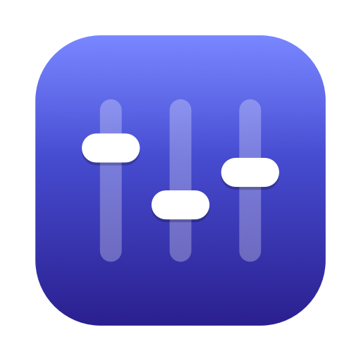

# Volume Mixer



A menu bar app that gives every Mac app its own volume slider and mute button, like the Windows volume
mixer. No audio driver to install: it uses the Core Audio process taps that macOS 14.4 and later
provide.

- One row per app that is playing sound, plus the output device's own volume
- Browser and Electron helper processes (Chrome, Safari's WebKit, Discord) fold into their app
- Volumes are remembered per app between launches
- Apps at 100% are never touched; only apps you turn down or mute are routed
- Follows output device changes (headphones, AirPods, displays)
- Open at login

## Requirements

- macOS 14.4 or later
- Swift 5.9 or later (the Command Line Tools are enough, Xcode is not needed)

## Build and run

```sh
scripts/build.sh            # builds build/VolumeMixer.app
scripts/build.sh run        # builds and launches it
scripts/build.sh install    # copies it to /Applications and launches it
scripts/check.sh            # build without warnings, core checks, bundle checks
```

The first time you turn an app down, macOS asks to let Volume Mixer record system audio. Allow it:
that is how the app's sound reaches the mixer. If you said no, turn it on under System Settings →
Privacy & Security → Screen & System Audio Recording → System Audio Recording Only.

The app is signed ad hoc, so macOS treats every new build as a new app and asks for the permission
again. Signing with a certificate (`SIGN_IDENTITY="Apple Development: …" scripts/build.sh`) keeps the
permission across builds.

## How it works

For each app below 100% the mixer creates a muted process tap, which captures the app's audio before
it reaches the speakers, and a private aggregate device that contains the tap and the real output
device. The aggregate device's IO callback copies the tapped audio to the output at the app's gain.
Taps and aggregate devices are private to the mixer, so if it quits or crashes macOS removes them and
every app plays normally again.

| Path | What |
|---|---|
| `Sources/MixerCore` | Real-time renderer, volume curve and saved settings (no Core Audio objects) |
| `Sources/VolumeMixer/CoreAudio` | HAL access: process list, taps, output device, permission |
| `Sources/VolumeMixer/Mixer` | `MixerModel`, which decides which apps are routed and when |
| `Sources/VolumeMixer/Views` | The menu bar panel |
| `Checks/MixerCoreChecks` | Checks for `MixerCore`, run by `scripts/check.sh` |

## Debugging

```sh
build/VolumeMixer.app/Contents/MacOS/VolumeMixer --list              # audio clients and how they are named
build/VolumeMixer.app/Contents/MacOS/VolumeMixer --snapshot /tmp     # panel rendered to PNG, routing off
/usr/bin/log stream --predicate 'subsystem == "com.rokoov.volumemixer"'
```
